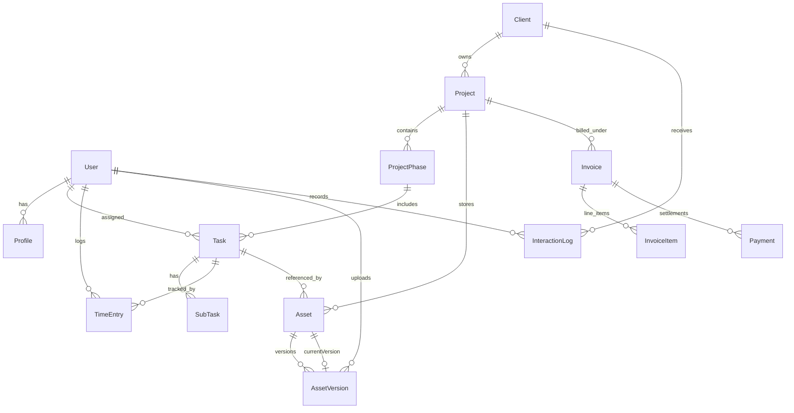

# 🌌 Project "WORKSPACE" ERP
### *Enterprise Resource Planning & Operations Platform*

> Built with **Next.js 14 (App Router)**, **TypeScript (Strict Mode)**, **Prisma ORM**, **PostgreSQL (Supabase Pooler)**, **Tailwind CSS**, **Framer Motion**, **TanStack Query v5**, and **Zustand**. Styled with the crisp **"Modern Enterprise"** aesthetic inspired by the **"Landed"** design system.

---

## 🏛️ Executive Summary & Architecture

**WORKSPACE ERP** is a full-scale, multi-tenant enterprise system engineered to handle client relationships, hierarchical project execution, real-time drag-and-drop workflows, immutable versioned asset vaults, time-tracking, automated invoicing pipelines, and a secure client portal.

```
┌────────────────────────────────────────────────────────────────────────┐
│                        EDGE MIDDLEWARE GATEWAY                         │
│               Strict RBAC: SUPERADMIN | EMPLOYEE | CLIENT               │
└───────────────────────────────────┬────────────────────────────────────┘
                                    │
    ┌───────────────────────────────┼───────────────────────────────┐
    ▼                               ▼                               ▼
┌───────────────┐           ┌───────────────┐               ┌───────────────┐
│ INTERNAL ERP  │           │ FINANCIAL ENG │               │ CLIENT PORTAL │
│ CRM & Engine  │           │ Invoicing & AR│               │ External Hub  │
│ Kanban Board  │           │ Auto Pipeline │               │ Pay Now Sim   │
│ Asset Vault   │           │ Payments      │               │ Asset Download│
└───────┬───────┘           └───────┬───────┘               └───────┬───────┘
        │                           │                               │
        └───────────────────────────┼───────────────────────────────┘
                                    │
                                    ▼
        ┌──────────────────────────────────────────────────────┐
        │              POSTGRESQL (SUPABASE DB)                │
        │      14 Normalized Tables & Relational Integrity     │
        └──────────────────────────────────────────────────────┘
```

---

## ⚡ Key Architectural Highlights

### 1. Zero-Trust Role-Based Access Control (RBAC)
- **Edge Middleware Perimeter Defense:** Route protection executes at the network edge in [src/middleware.ts](file:///Users/manoj/Downloads/Project%20ERP/src/middleware.ts) *before* page rendering.
- **Type-Augmented JWT & Session:** Extended NextAuth contracts via TypeScript type declarations (`src/types/next-auth.d.ts`) to ensure strict compile-time type safety across `SUPERADMIN`, `EMPLOYEE`, and `CLIENT`.
- **Role Permissions:**
  - `SUPERADMIN`: Complete platform authority, financial engine controller, invoice generation, payment settlement, and client CRM management.
  - `EMPLOYEE`: Access to Client CRM, Project Engine, Kanban Board, persistent Timer, and Asset Vault. Prohibited from financial receivables.
  - `CLIENT`: Confined strictly to `/portal` for viewing project hierarchy completion, downloading approved deliverables, and settling invoices.

### 2. High-Performance Kanban with Optimistic UI & Snap-Back Rollback
- Implemented with `@dnd-kit/core` and `@tanstack/react-query` in [src/components/kanban/kanban-board.tsx](file:///Users/manoj/Downloads/Project%20ERP/src/components/kanban/kanban-board.tsx).
- **Zero Latency Drag-and-Drop:** Moving cards between `TODO`, `IN_PROGRESS`, `REVIEW`, and `DONE` cancels outgoing queries, saves the previous cache snapshot, and applies an instant optimistic UI mutation.
- **Snap-Back Error Rollback:** If the network fails or the server rejects the transition, TanStack Query catches the error and snaps the card back to its exact previous position.

### 3. Hierarchical Project Engine & Automated Phase Triggers
- Normalized relational tree: `Project` $\rightarrow$ `ProjectPhase[]` $\rightarrow$ `Task[]` $\rightarrow$ `SubTask[]`.
- **Automated Lifecycle Trigger:** When the last task in a phase moves to `DONE`, an atomic Prisma transaction updates the phase status to `COMPLETED` and advances dependent phase statuses.

### 4. Global Persistent Timer & Timesheet System
- **Zustand State with SSR-Safe Storage:** Global timer in [src/store/useTimerStore.ts](file:///Users/manoj/Downloads/Project%20ERP/src/store/useTimerStore.ts) persists active task ID, project details, and elapsed seconds across page reloads and route navigations.
- **Timesheet View (`/time-tracking`):** Weekly/daily timesheet grid aggregating billable hours, hourly rates, and task metrics.

### 5. Immutable Versioned Asset Storage Vault
- **Non-Overwriting File Versioning:** Uploading a revised blueprint, contract, or 3D render in [src/app/actions/assets.ts](file:///Users/manoj/Downloads/Project%20ERP/src/app/actions/assets.ts) creates a new `AssetVersion` record (`v1` $\rightarrow$ `v2` $\rightarrow$ `v3`) while preserving all historical file paths and changelogs.
- **Atomic Pointer:** `Asset.currentVersionId` points to the active version while historical revisions remain accessible in the timeline modal.

### 6. Automated Financial Engine & The Unbroken Atomic Chain
- **The Core Linkage:** `Timer` $\rightarrow$ `TimeEntry` $\rightarrow$ `Invoice` $\rightarrow$ `Payment`.
- **Automated Billing Pipeline:**
  1. Queries unbilled billable `TimeEntry` records (`isBillable = true`, `isBilled = false`) for a project.
  2. Aggregates duration, applies hourly rate calculations, and formats itemized deliverables.
  3. Inside an atomic Prisma `$transaction`:
     - Creates the `Invoice` record with unique sequence numbering (`INV-YYYY-XXXX`).
     - Creates itemized `InvoiceItem` records.
     - **Atomically updates all included `TimeEntry` records to `isBilled = true`**.
- **Payment Processing:** Supports recording client payments, tracking partial settlements, and auto-transitioning invoice statuses to `PAID`.

### 7. Client Portal (`/portal`)
- **External Client Hub:** Clean 3-tab layout:
  1. **My Project Progress:** Real-time completion progress bars, phase milestones, and task statuses.
  2. **My Approved Assets:** Direct one-click downloads of verified blueprint and contract versions.
  3. **My Invoices & Billing:** Itemized statements, balance due tracking, and interactive **Pay Now** instant payment simulation.

---

## 🗄️ Database Schema (14 Normalized Tables)



---

## 🎨 Design System: "Liquid Glass" Aesthetic

- **Theme Palette:** Deep `#0a0a0a` charcoal canvas with ambient color glows (indigo, cyan, emerald, amber).
- **Glassmorphism:** Multi-layered translucent backdrops (`backdrop-blur-xl`, `bg-zinc-950/70`, `border-white/[0.08]`).
- **Motion:** Subtle route transitions and tab switching powered by `framer-motion`.

---

## 🚀 Getting Started

### 1. Prerequisites
- Node.js 18+ or 20+
- PostgreSQL database (or Supabase instance)

### 2. Environment Configuration
Create a `.env` file in the root directory:
```env
DATABASE_URL="postgresql://postgres.[USER]:[PASSWORD]@[HOST]:5432/postgres"
NEXTAUTH_SECRET="your-secure-random-nextauth-secret-key-32-chars-min"
NEXTAUTH_URL="http://localhost:3000"
```

### 3. Database Migration & Seeding
```bash
# Push schema to database
npx prisma db push

# Generate Prisma Client
npx prisma generate
```

### 4. Running the Development Server
```bash
npm run dev
```
Open [http://localhost:3000](http://localhost:3000) to view the application.

### 5. Production Build
```bash
npm run build
npm run start
```

---

## 🔑 Demo Access Credentials

The database comes pre-seeded with 3 primary test accounts covering every security role:

| Role | Email | Password | Allowed Access |
| :--- | :--- | :--- | :--- |
| **SUPERADMIN** | `admin@workspace.erp` | `Admin@123456` | Full Platform & Financial Controller |
| **EMPLOYEE** | `employee@workspace.erp` | `Employee@123456` | CRM, Projects, Kanban, Timers, Assets |
| **CLIENT** | `client@workspace.erp` | `Client@123456` | Restricted Client Portal (`/portal`) |

*(One-click quick login buttons for all three roles are also available on the `/login` screen).*

---

## 📂 Project Structure

```
├── prisma/
│   └── schema.prisma         # Normalized database models & relations
├── src/
│   ├── app/
│   │   ├── actions/          # Next.js Server Actions (Assets, Invoicing, Portal, Projects)
│   │   ├── api/              # API Route Handlers (Auth, Tasks, Uploads)
│   │   ├── assets/           # Versioned Asset Vault page
│   │   ├── crm/              # Client CRM & Interaction logs
│   │   ├── dashboard/        # Operational Matrix & Quick Access
│   │   ├── financials/       # SuperAdmin Financial Pipeline & Accounts Receivable
│   │   ├── kanban/           # dnd-kit Drag-and-drop Kanban board
│   │   ├── login/            # Role-based credential authentication
│   │   ├── portal/           # Client Portal (Health, Assets, Invoices, Pay Now)
│   │   ├── projects/         # Project Engine & Phase/Task hierarchy
│   │   ├── time-tracking/    # Weekly Timesheet & Entry Management
│   │   ├── globals.css       # Modern Enterprise tokens (Landed palette, light base, cards)
│   │   └── layout.tsx        # Root layout with PageTransitions & Providers
│   ├── components/
│   │   ├── assets/           # Asset grid, upload modal, version history modal
│   │   ├── crm/              # CRM table, interactions modal, client card
│   │   ├── financials/       # Invoices table, invoice generator, detail modal
│   │   ├── kanban/           # Column containers, draggable cards, priority badges
│   │   ├── navigation/       # TopNavbar with persistent timer
│   │   ├── portal/           # ClientPortalView (Progress, Assets, Invoices)
│   │   ├── projects/         # Hierarchy view, phase triggers, project cards
│   │   └── time-tracking/    # Timesheet table, entry logging modals
│   ├── lib/
│   │   ├── auth.ts           # NextAuth configuration
│   │   └── prisma.ts         # PrismaClient singleton pool
│   ├── middleware.ts         # Edge RBAC Middleware
│   ├── store/
│   │   └── useTimerStore.ts  # Zustand global timer store with SSR persistence
│   └── types/
│       └── next-auth.d.ts    # TypeScript type augmentation for sessions & JWT
└── README.md
```
